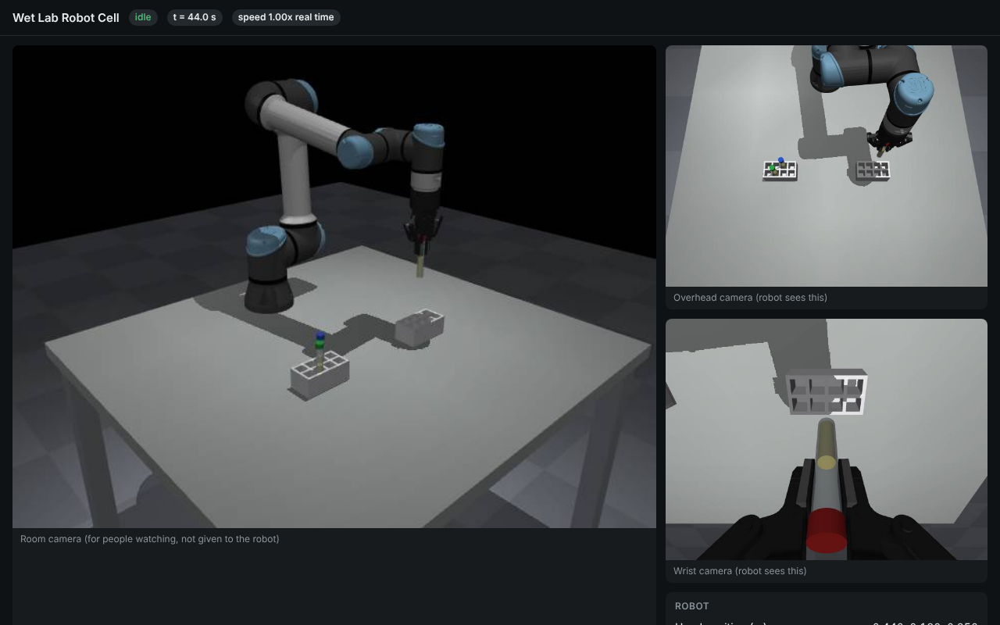

# Wet Lab Sim



A realistic, real-time robot cell for testing how well AI agents (Claude Code,
Codex, Devin) can control a robot arm in a wet lab.

A simulated **Franka Emika Panda arm** with its **Franka Hand gripper** stands on a lab bench with
tube racks, 15 ml tubes and other lab items. Physics runs in [MuJoCo](https://mujoco.org) and never
pauses. Agents control the arm by writing Python against a robot API that mirrors
real hardware. They only get what a real robot would have: camera images (with
depth), joint readings, wrist force, and gripper status. Nobody tells them where the
tubes are.

## Quick start (Mac or Linux)

```bash
git clone https://github.com/davidfromkansas/wetlabsim && cd wetlabsim
python3 -m venv .venv && source .venv/bin/activate
pip install -e .

# 1. Start the robot cell, then open http://localhost:8765 to watch it live
python -m wetlabsim.server

# 2. In a second terminal, give an agent a task
python -m wetlabsim.run_agent --agent claude --task "Move the tube with the red cap into an empty slot of the other rack."
python -m wetlabsim.run_agent --agent codex  --task "Move the tube with the red cap into an empty slot of the other rack."
```

Claude Code and Codex use your existing logins, so no API keys are needed. Install
them first if you haven't: `npm i -g @anthropic-ai/claude-code @openai/codex`.

Devin works the same way through the Devin CLI (`--agent devin`). Install it with
`curl -fsSL https://cli.devin.ai/install.sh | bash` (or `brew install --cask devin-cli`),
then run `devin auth login` once. Devin is only allowed to run Python, edit files in its
own workspace and use the robot tools.

By default agents get what a lab would hand over with a real Franka: Franka's own
documents unchanged (copies in `agent/datasheets/`, see `SOURCES.md` there), a short site sheet and
camera calibration, the robot-only MuJoCo model, and a command reference without tips
(`agent/franka/`). `--docs assisted` gives them our hand-written manual with tips and
pixel/point helpers instead. The simulator's speed, acceleration, force-sensing and
protective-stop limits follow Franka's published numbers (sources in
`agent/datasheets/SOURCES.md`). `python -m wetlabsim.datasheets` checks Franka's files
against their recorded checksums and re-downloads any that are missing.

The arm is a Franka Panda by default. To run the earlier UR5e + Robotiq 2F-85 cell
instead, start the server with `--robot ur5e` (or set `WETLAB_ROBOT=ur5e`); agents
automatically get that robot's manual.

On a Linux machine with no screen, add `MUJOCO_GL=egl` (NVIDIA GPU) or
`MUJOCO_GL=osmesa` (CPU only) before the server command.

There's also a hand-written baseline that solves the same task using only the
cameras: `python examples/scripted_pick_place.py`.

## How it fits together

| Part | File | What it does |
| --- | --- | --- |
| Scene | `wetlabsim/scene.py` | Bench, racks, tubes, cameras, the arm and gripper (robot models from [MuJoCo Menagerie](https://github.com/google-deepmind/mujoco_menagerie), lab items from [AutoBio](https://github.com/autobio-bench/AutoBio)). |
| Robot cell | `wetlabsim/sim.py`, `wetlabsim/server.py` | Real-time physics, the arm's motion controller, sensors, safety stops, cameras, and the live viewer. |
| Robot API | `wetlabsim/robot.py` | What agents' code imports: `move_l`, `gripper_move`, `get_camera_frame`, and so on. |
| Agent plug | `wetlabsim/mcp_server.py` | MCP tools so agents can look through the cameras, read the robot state, and hit stop. |
| Robot manual | `agent/ROBOT_MANUAL_<robot>.md` | What agents read first, like a manual a lab tech would hand you. |
| Run recorder | `wetlabsim/run_agent.py` | Resets the cell, runs one agent on one task, saves everything. |

### What makes it realistic

- **Time never stops.** While the model thinks, the arm holds its last position.
- **No hidden knowledge.** Agents get cameras (overhead and wrist, colour and depth, calibrated), joint angles, wrist force/torque with ~0.3 N noise, and gripper status, including "object detected".
- **Real controller behaviour.** Straight-line moves, joint moves, unreachable poses are rejected, and a hard bump triggers a protective stop that has to be cleared.
- **Real physics.** Tubes can slip, tip over or get knocked out of their racks.

### What each run saves

Each run creates `runs/<date>-<agent>/` with:

- `task.txt`
- `transcript.jsonl` (everything the agent said and did)
- `states.jsonl` (the robot's readings and the true object positions, 20 times a second, plus every command)
- `result.json` (time taken, commands sent, protective stops, final object positions)
- `workspace/` (the code the agent wrote)

Scoring rules per task come next.

## MuJoCo physics settings

Every MuJoCo setting the bench uses, by its MuJoCo name, with MuJoCo's default, the value
we run, a plain-English explanation and a link to the MuJoCo docs:
[docs/physics-settings.html](docs/physics-settings.html) (open it in a browser). The live,
editable copy, where choices are saved for Claude to apply, is
[on claude.ai](https://claude.ai/artifact/7rsi22YcN92XsCFDaWktDy).

In the code, contact properties are set per material (MuJoCo default classes) in
`MATERIALS` in `wetlabsim/scene.py`, and solver options in `OPTION` and `FLAGS` there.
`scripts/physics_checks.py` measures grip creep, release, sinking and speed after a change.

## Playground (free play, LIBERO tests, Wet Lab tests)

A web page for building a scene and giving the Franka a task, running on your Mac:

```bash
pip install -e .
python -m playground.server        # opens http://localhost:8780
```

Three modes, picked in the header:

- **Free play**: drag NVIDIA SimReady objects (with their own MuJoCo physics) onto the
  packing table, click the robot, type a task, pick Claude Code or Codex, and press Play.
  The AI writes code to move the robot and its chat shows live. Nothing is graded or saved,
  and there's no time limit.
- **LIBERO test**: the four suites Anthropic's study used (LIBERO-40): Goal, Spatial, Object
  and Long, 10 tasks each, each in LIBERO's own room with its own objects and its 50 official
  starting setups. LIBERO's own success rule decides pass or fail, live. Run one setup, all
  50, or the study set (setups 1 to 5 of all 40 tasks, the same 200 runs as the study).
  Results go to `runs/playground/libero_results.jsonl`, with a scoreboard per task, per suite
  and across models. We use our Franka controller, not LIBERO's, so scores don't compare
  with LIBERO's leaderboard. 3 minutes per run.
- **Wet Lab**: the robot cell's own bench and its 8 tasks (`wetlabsim/tasks.py`), each scored
  at the end by the task's own check, as in the robot cell's evals. Results go to
  `runs/playground/wetlab_results.jsonl`. 15 minutes per run.

Runs use your existing Claude Code or Codex login.

The SimReady objects are in `playground/assets` (to rebuild: `python -m playground.tools.build_assets`, from Hugging Face:
NVIDIA SimReady, Tripo, QUIKTECH and NVIDIA USDCraft-10K). AutoBio's lab items come from `playground.tools.build_autobio`
and `playground.tools.build_autobio_mjcf` (AutoBio's own MuJoCo models), and the items we modelled ourselves (24-well
plate and lid, glass test tubes, stirring rod, stir bar, hot plate, target mark) from `playground.tools.build_inhouse`
(Blender's Python module, `pip install bpy`). Each library card shows where its item comes from. Credits:
`playground/assets/CREDITS.md`.

LIBERO's scenes are LIBERO's own: every task was built once in LIBERO's stack (robosuite 1.4,
MuJoCo 2.3) and its compiled model saved (`playground/tools/libero_export.py`), then
made loadable in MuJoCo 4 with our Franka in place of robosuite's Panda
(`playground/tools/import_libero.py`). The scenes, goals and starting setups are in
`playground/libero_assets/suites`. LIBERO's meshes and textures (about 200 MB) are downloaded
from LIBERO's GitHub on first use, checked against `playground/libero_assets/manifest.json`;
to fetch them ahead of time: `python -m playground.tools.fetch_libero`. Our success
checks were compared with LIBERO's own on test scenes recorded in its stack
(`playground/tools/libero_crosscheck.py`, checked by `tests/test_libero.py`).

## Notes

- The true object positions are only available to the run recorder, via a token saved in `runs/.eval_token`. Agents aren't given it, but they run on your machine as you, so a determined agent could find it. Check transcripts when results look too good.
- Agents run with permission to execute code. Run them on a machine you're comfortable with (the cloud machine is a good choice).
- Robot models are © their authors under their own licences: see `wetlabsim/assets/*/LICENSE`.

## Credits

The playground's objects are NVIDIA SimReady and Tripo SimReady assets (Hugging Face
`nvidia/simready-assets`, `VAST-AI/Tripo-Simready-Assets`), CC BY 4.0: every item and its
source is listed in [`playground/assets/CREDITS.md`](playground/assets/CREDITS.md).
LIBERO's scenes, objects, tasks and starting setups come from
[LIBERO](https://github.com/Lifelong-Robot-Learning/LIBERO) (licence in `playground/libero_assets/LICENSE`).

The tubes, tube racks, 60-well rack and petri dish are 3D models from **AutoBio**, used
with credit (the AutoBio repository has no licence file). Details in
[`wetlabsim/assets/autobio/NOTICE.md`](wetlabsim/assets/autobio/NOTICE.md).

> Zhiqian Lan, Yuxuan Jiang, Ruiqi Wang, Xuanbing Xie, Rongkui Zhang, Yicheng Zhu,
> Peihang Li, Tianshuo Yang, Tianxing Chen, Haoyu Gao, Xiaokang Yang, Xuelong Li,
> Hongyuan Zhang, Yao Mu, Ping Luo. *AutoBio: A Simulation and Benchmark for Robotic
> Automation in Digital Biology Laboratory.* arXiv:2505.14030, 2025.
> https://github.com/autobio-bench/AutoBio
